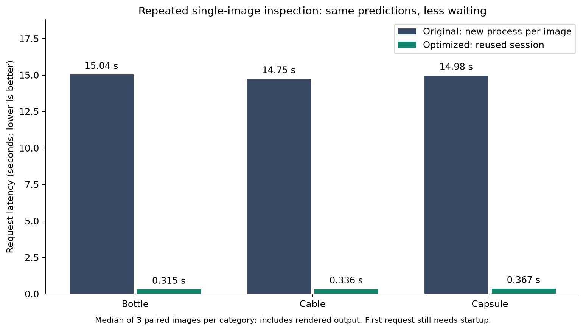

# 单图检测会话复用优化报告

在原有无损存储优化之外，本轮增加 **连续检测响应时间优化**。相同模型的后续请求复用 Python 进程和已加载权重，保持 anomalib 原始预处理、模型前向、后处理与可视化路径。每次请求创建独立 Engine，隔离回调及输出目录。

## 实测结果

RTX 3050 Laptop 4 GB、CUDA、batch=1。每类别使用 seed 42 的 3 张固定测试图，同一图片交替运行两种方式。下表为每类别 3 次请求的中位数。

| 类别 | 原流程秒 | 复用后秒 | 延迟减少 | 比值 | 新服务首次请求秒 |
|---|---:|---:|---:|---:|---:|
| bottle | 15.038 | 0.315 | 97.91% | 47.8× | 14.74 |
| cable | 14.745 | 0.336 | 97.72% | 43.9× | 13.15 |
| capsule | 14.978 | 0.367 | 97.55% | 40.8× | 14.68 |



计时从客户端发起请求到结果 JSON 和可视化 PNG 落盘完成。原流程包含进程退出；优化流程返回响应后保持服务。两者都是实际完成请求的时间，**不包含浏览器上传、页面轮询或用户操作**。GUI 在单图任务期间每 0.5 秒检查一次完成状态。原实现快照来自提交 `ce49ccfa7a26393aaeb8393ad9684e557ecaa52f` 的 `course/predict.py`，SHA256 为 `b0fbc3db7dfbd412f80b98afa307f8fb2605162a04281258ae966d353fc82df2`。

首张图、空闲超时后的首张图仍有进程启动成本；切换模型需重新加载权重。这里的比值不是神经网络前向加速比，也不能用于声称大批量吞吐提升。9 次计时只反映本机当前负载，原始逐次测量保存在 JSON。

## 检测质量不退化

固定原来的 bottle、cable、capsule × seed 42/43/44，共 9 个 checkpoint。逐文件检查已有数据划分与图像 SHA256，复用前后各运行一次真实单图接口，再核对全部最终测试图的模型原始输出。

- **552 次测试图像评估**的原始异常得分与异常图逐位一致；这些是跨种子的评估次数，包含重复图片。
- 9 个模型各复核一次原始/缓存单图请求，后处理得分、标签、异常图、缺陷掩码哈希完全一致。
- 对复用模型再次执行上游 `Engine.test`，9 组的图像 AUROC、图像 F1、像素 AUROC、像素 F1 与冻结的原始实验记录逐项严格相等。
- 计时使用的 9 对原流程/复用请求，其结果记录和可视化 PNG 字节也全部相同。

以下为各类别 3 种子的均值（复用前后相同）。

| 类别 | 图像 AUROC | 图像 F1 | 像素 AUROC | 像素 F1 | 四指标变化 |
|---|---:|---:|---:|---:|---|
| bottle | 1.000000 | 0.994709 | 0.981259 | 0.688503 | 全部 0 |
| cable | 0.984008 | 0.938155 | 0.985468 | 0.678130 | 全部 0 |
| capsule | 0.952020 | 0.958012 | 0.983365 | 0.491633 | 全部 0 |

## 生命周期与资源代价

GUI 仅缓存一个模型，模型路径、设备、checkpoint 或元数据文件大小/修改时间改变时重新加载。空闲 120 秒、开始训练或退出 GUI 时释放工作进程；异常响应清除缓存，退出失联可重新启动。所有任务保持串行。每次输出目录加随机后缀，连续快速请求也不会覆盖。

复用需要暂时保留 Python、模型及 CUDA 运行时资源，**并不宣称空闲内存/显存不增加**。收益是检测质量保持不变时减少连续交互的等待；原有 75.63% 组合部署包缩减仍然成立。若要求每个时刻所有资源指标都不增加，应使用原单次 CLI 模式。

GUI 已核验模型选择、真实历史结果、复用状态和处理耗时展示。浏览器文件上传后的完整操作链未重新测试；推理验证通过现有本地数据集完成。

## 复现

在项目根目录运行：

```powershell
.\.venv\Scripts\python.exe course/audit_session.py verify
.\.venv\Scripts\python.exe course/audit_session.py benchmark
.\.venv\Scripts\python.exe course/report_session.py
.\.venv\Scripts\python.exe -m unittest discover -s course -p "test_*.py"
```

GUI 启动后自动使用复用服务，`course/predict.py --image ... --run ...` 仍提供单次独立进程模式。实验数据和模型在本地 `course/outputs`；GitHub 仅提交源码、汇总及报告。
