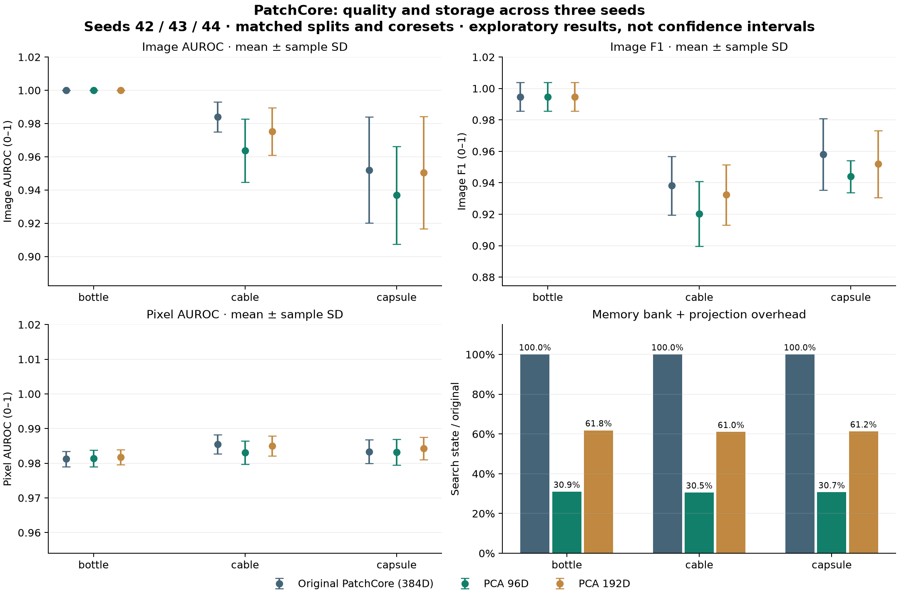

# 多随机种子实验：96 / 192 维 PCA 对比

本报告完成三个类别 × 三种方法 × 三个种子，共 27 组实验。旧的单种子报告保留为历史记录。

## 实验设置与复现

固定种子 42、43、44，类别 bottle、cable、capsule，方法 baseline、pca96、pca192。复用同一版本已完成实验，未删除或替换不利结果。每个类别/种子下，三种方法的数据划分、骨干配置与压缩前 coreset 哈希均相同。

PCA 仅拟合正常训练特征库，验证集校准阈值，测试集评估。种子同时改变数据划分和 coreset 随机过程，所以波动包含这两种因素。只使用 3 类共 1,017 张图像；各随机划分共享同一批数据，不能当成 3 个独立外部测试集。

执行 `python course/experiment_suite.py` 可续跑固定矩阵，`python course/summarize_experiments.py` 重新生成报告。环境仍由 uv 管理。

## 质量：均值 ± 样本标准差（n=3）

| 类别 | 方法 | 图像 AUROC | 图像 F1 | 像素 AUROC | 像素 F1 |
|---|---|---:|---:|---:|---:|
| bottle | baseline | 1.0000 ± 0.0000 | 0.9947 ± 0.0092 | 0.9813 ± 0.0022 | 0.6885 ± 0.0044 |
| bottle | pca96 | 1.0000 ± 0.0000 | 0.9947 ± 0.0092 | 0.9814 ± 0.0024 | 0.6901 ± 0.0083 |
| bottle | pca192 | 1.0000 ± 0.0000 | 0.9947 ± 0.0092 | 0.9818 ± 0.0022 | 0.6946 ± 0.0030 |
| cable | baseline | 0.9840 ± 0.0089 | 0.9382 ± 0.0187 | 0.9855 ± 0.0028 | 0.6781 ± 0.0327 |
| cable | pca96 | 0.9638 ± 0.0191 | 0.9202 ± 0.0207 | 0.9831 ± 0.0034 | 0.6746 ± 0.0294 |
| cable | pca192 | 0.9753 ± 0.0143 | 0.9324 ± 0.0192 | 0.9850 ± 0.0029 | 0.6810 ± 0.0289 |
| capsule | baseline | 0.9520 ± 0.0319 | 0.9580 ± 0.0228 | 0.9834 ± 0.0034 | 0.4916 ± 0.0259 |
| capsule | pca96 | 0.9369 ± 0.0294 | 0.9440 ± 0.0102 | 0.9832 ± 0.0037 | 0.4728 ± 0.0233 |
| capsule | pca192 | 0.9505 ± 0.0338 | 0.9519 ± 0.0214 | 0.9843 ± 0.0033 | 0.4987 ± 0.0206 |

标准差为 ddof=1，不是置信区间，也不是显著性检验。AUROC 极小的浮点舍入误差保留在原始 JSON 中。

## 相对于原始基线的配对变化

| 类别 | 压缩方法 | 检索状态减少 % | 图像 AUROC 变化（百分点） | 图像 F1 变化（百分点） | 像素 AUROC 变化（百分点） |
|---|---|---:|---:|---:|---:|
| bottle | pca96 | 69.078 ± 0.000 | 0.000 ± 0.000 | 0.000 ± 0.000 | 0.014 ± 0.080 |
| bottle | pca192 | 38.217 ± 0.000 | 0.000 ± 0.000 | 0.000 ± 0.000 | 0.053 ± 0.046 |
| cable | pca96 | 69.476 ± 0.000 | -2.024 ± 1.169 | -1.795 ± 1.081 | -0.236 ± 0.087 |
| cable | pca192 | 39.009 ± 0.000 | -0.875 ± 0.573 | -0.580 ± 0.738 | -0.049 ± 0.027 |
| capsule | pca96 | 69.347 ± 0.000 | -1.515 ± 0.922 | -1.406 ± 1.397 | -0.019 ± 0.078 |
| capsule | pca192 | 38.753 ± 0.000 | -0.152 ± 0.546 | -0.607 ± 1.332 | 0.091 ± 0.026 |

检索状态包含特征库、投影均值和矩阵。96 维特征库本身减少 75%，192 维减少 50%，但加上投影开销后，实际总检索状态收益更小。该指标不是模型文件大小或总显存。

## 模型大小与耗时

| 类别 | 方法 | 检索状态 KiB | 模型文件 MiB | 前向中位 ms（各实验的均值 ± SD） |
|---|---|---:|---:|---:|
| bottle | baseline | 2457.0 ± 0.0 | 13.13 ± 0.00 | 31.33 ± 3.52 |
| bottle | pca96 | 759.8 ± 0.0 | 11.47 ± 0.00 | 29.07 ± 1.80 |
| bottle | pca192 | 1518.0 ± 0.0 | 12.21 ± 0.00 | 32.15 ± 0.97 |
| cable | baseline | 2634.0 ± 0.0 | 13.30 ± 0.00 | 32.50 ± 0.26 |
| cable | pca96 | 804.0 ± 0.0 | 11.52 ± 0.00 | 31.02 ± 4.69 |
| cable | pca192 | 1606.5 ± 0.0 | 12.30 ± 0.00 | 31.08 ± 2.28 |
| capsule | baseline | 2574.0 ± 0.0 | 13.24 ± 0.00 | 31.10 ± 3.18 |
| capsule | pca96 | 789.0 ± 0.0 | 11.50 ± 0.00 | 28.92 ± 2.72 |
| capsule | pca192 | 1576.5 ± 0.0 | 12.27 ± 0.00 | 31.96 ± 0.64 |

每次实验预热 10 次，对第一张测试图进行 30 次 CUDA 同步前向计时；表中汇总三个实验各自的中位数。计时包含骨干、投影、检索与原始异常图，不含读图、预处理、阈值后处理与显示。部分种子 42 数据复用先前运行，测量时段和笔记本负载不受控；这里只作描述，不能证明稳定加速。

## 解释边界

- 可以据此量化存储减少以及各类别的质量权衡；没有预设压缩必定提高精度。
- 96/192 维比较属于探索性实验。看到测试结果后选择维度，不能再把同一测试集当成完全未参与方案选择的最终验收数据。
- 若把先前示例目标“存储至少减少 50%、每类别平均图像 AUROC 下降不超过 1 个百分点”作为验收要求，必须逐项核验；192 维含投影后的存储收益可能不足 50%。不能只因精度更好就改称已达到原目标。
- 后续正式验收应先固定方法和阈值，再使用额外未参与方案选择的类别或独立数据。

[27 组逐次指标](results/multiseed_metrics.csv) · [均值和标准差](results/multiseed_summary.csv) · [原始 JSON 与哈希](results/multiseed_metrics.json)

## 本轮结论

以下判断基于已观察的测试结果，属于探索性结论。各项收益均按类别统计，不能推广为所有工业场景的保证。

- pca96：检索状态减少 69.08%–69.48%；各类别平均图像 AUROC 的最大下降为 2.024 个百分点。未同时满足先前示例中的“存储至少减少 50%、每类别平均图像 AUROC 下降不超过 1 个百分点”两项条件。
- pca192：检索状态减少 38.22%–39.01%；各类别平均图像 AUROC 的最大下降为 0.875 个百分点。未同时满足先前示例中的“存储至少减少 50%、每类别平均图像 AUROC 下降不超过 1 个百分点”两项条件。

平均值满足某项限制，并不代表每个种子都满足。可以结合上表选择精度和存储之间的折中，但正式验收应使用预先固定的方案与独立数据。
