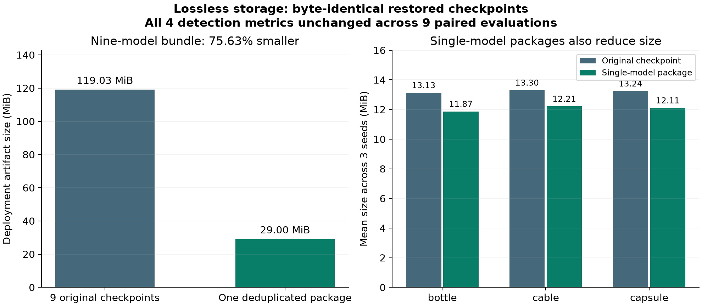

# 保持原始检测指标的无损模型存储优化

**最终采用：无损压缩与跨模型去重。** 9 个原始 PatchCore 模型从 119.03 MiB 压缩到 29.00 MiB，部署包减少 **75.63%**。单模型无需跨模型去重也有收益，见下表。



## 为什么不会损失精度

不同类别和随机种子的 checkpoint 重复保存了相同的预训练骨干等张量。新增打包工具按原 ZIP 数据区边界拆分文件，对字节内容做 SHA-256 去重，再用 Deflate 6 无损压缩。每个模型保存恢复配方，所有原 ZIP 头、填充和目录字节也完整保留。

恢复过程逐块验证 SHA-256，最终再核验整个 checkpoint 的字节数与 SHA-256。恢复文件与原文件逐字节相同；不是量化、PCA、剪枝，也不改变骨干、特征库、数据划分、阈值或推理代码。

已恢复并验证全部 9 个原始模型，逐项比对 state_dict，再用原始 Engine.test 完成 552 次测试图像评估。9 组的图像 AUROC、图像 F1、像素 AUROC、像素 F1 与原始记录全部完全一致。多个种子复用同一数据集，评估次数不等于独立图片数量。

## 单个模型也能节省存储

| 类别 | 原始模型 MiB，三种子均值 | 单模型包 MiB | 体积减少 | 四项检测指标 |
|---|---:|---:|---:|---|
| bottle | 13.13 | 11.87 | 9.59% | 全部不变 |
| cable | 13.30 | 12.21 | 8.18% | 全部不变 |
| capsule | 13.24 | 12.11 | 8.59% | 全部不变 |

## 原始与恢复后的指标（三种子均值相同）

| 类别 | 图像 AUROC | 图像 F1 | 像素 AUROC | 像素 F1 |
|---|---:|---:|---:|---:|
| bottle | 1.0000 | 0.9947 | 0.9813 | 0.6885 |
| cable | 0.9840 | 0.9382 | 0.9855 | 0.6781 |
| capsule | 0.9520 | 0.9580 | 0.9834 | 0.4916 |

## 指标边界与使用成本

- 改进指标是**部署包字节数**。原始基线是已有的原生 PyTorch checkpoint，不是另一个专门压缩后的归档方案。多模型收益取决于共享内容，单模型收益单独报告。
- 恢复之后使用完全相同的原始模型和推理路径，不新增推理缓存或压缩步骤；原始训练与检测代码未改动。本轮没有声称推理加速、训练加速或 GPU 显存下降。
- 打包 9 个模型实测约 2.06 秒；从组合包恢复一个模型约 0.104–0.134 秒。这是额外的一次性部署操作，不计入模型前向耗时。
- 包不能直接交给 torch.load，需要先恢复。可只恢复要部署的模型。打包与恢复都保留原文件，当前本地磁盘因为还保留备份和验证产物，不会自动空出 75.63% 的空间。
- 格式具备校验但不具备签名认证；只加载自己生成、来源可信的 checkpoint。SHA-256 一致性不意味着任意来源的 pickle 都可安全加载。

## 本地使用

组合包：`course/outputs/lossless-20261020-153336/baseline-9-models.alpack`。GUI 新增“无损部署”页，可查看体积和一致性验证，也可下载已生成的组合包或单个模型包。

在项目根目录执行（模型 ID 可从 GUI 或 CSV 复制）：

```powershell
.\.venv\Scripts\python.exe course\lossless_package.py pack --run bottle-baseline-20261019-092413 --output course\outputs\my-model.alpack
.\.venv\Scripts\python.exe course\lossless_package.py restore --package course/outputs/lossless-20261020-153336/baseline-9-models.alpack --run bottle-baseline-20261019-092413 --output course/outputs/restored-bottle/baseline.ckpt
```

重复恢复到相同内容的文件会直接复用；若目标已有不同内容则拒绝覆盖。恢复不依赖原来的 checkpoint 文件。参数选择不涉及检测集调参。

## 未采用的方案

PCA96/PCA192 的质量损失仍保留在此前报告。本轮还测试了中间张量提前释放与近邻分块：在验证集筛选、冻结 196 分块后，完整测试的分数与热力图一致，但部分组没有显存收益且耗时上升，因此没有接入默认检测流程，也不计为最终优化成果。

[无损逐次验证 JSON](results/lossless_metrics.json) · [CSV](results/lossless_metrics.csv) · [未采用的显存实验原始数据](results/search_exploration.json)
