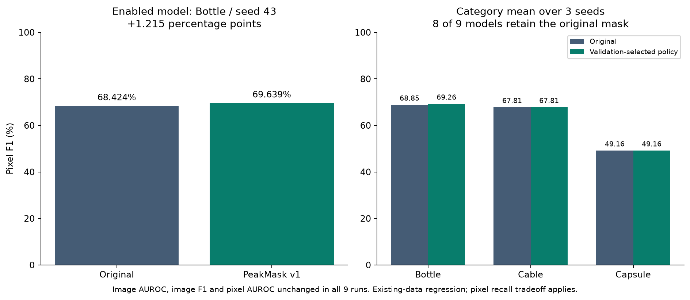

# 精度优化提升对比报告：PeakMask v1

日期：2026-10-25。项目：Inspection Lab · 基于 anomalib / PatchCore 的工业缺陷检测与部署效率优化。

## 结论

在保留既有无损模型打包与推理会话复用的基础上，本轮实现 **峰值自适应缺陷掩码（PeakMask v1）**。采用测试前冻结的验证集启用规则，9 组中只有 **瓶子 / 种子 43** 启用 `alpha=0.05`，其余 8 组在测试前即确定保持原处理。

该模型的 **像素级 F1 从 0.684238 提升到 0.696388，增加 1.215 个百分点（相对提升 1.776%）**。瓶子三个种子的平均提升为 0.405 个百分点；电缆和胶囊没有提升，保持原结果。

**9 组的原有四项检测指标均未下降，552 次测试图像评估完成。** 这里的提升是缺陷分割 F1，不是分类准确率或 AUROC 提升。552 是跨种子的评估次数，含重复图片。

**存在取舍：像素精确率提高、像素召回率下降；推理耗时略增。** 因此不宣称“所有指标都改善”，GUI 保留原基线为默认，把 PeakMask 注册为单独可选模型。



## 单个启用模型的四项指标

源模型：`bottle-baseline-20261019-204429`。优化后模型：`bottle-peak_mask-20261025-224818`。最终测试图片数：42。

| 指标 | 原始 | 优化后 | 变化（百分点） |
|---|---:|---:|---:|
| image_AUROC | 1.000000 | 1.000000 | +0.000000 |
| image_F1Score | 1.000000 | 1.000000 | +0.000000 |
| pixel_AUROC | 0.983626 | 0.983626 | +0.000000 |
| pixel_F1Score | 0.684238 | 0.696388 | +1.215088 |

以图片为重采样单位、固定随机种子、2000 次配对 bootstrap，测试像素 F1 增益的描述性 95% 区间为 **[0.501, 1.930] 个百分点**。该区间不代表已通过外部数据泛化检验，也没有对候选选择进行多重比较校正。

## 全部九组：不隐藏无收益组

| 类别 | 种子 | alpha | 原始像素 F1 | 优化像素 F1 | 变化（百分点） | 图像 AUROC / 图像 F1 / 像素 AUROC |
|---|---:|---:|---:|---:|---:|---|
| bottle | 42 | 0.00 | 0.693075 | 0.693075 | +0.000000 | 三项不变 |
| cable | 42 | 0.00 | 0.640455 | 0.640455 | +0.000000 | 三项不变 |
| capsule | 42 | 0.00 | 0.504471 | 0.504471 | +0.000000 | 三项不变 |
| bottle | 43 | 0.05 | 0.684238 | 0.696388 | +1.215088 | 三项不变 |
| cable | 43 | 0.00 | 0.695477 | 0.695477 | +0.000000 | 三项不变 |
| capsule | 43 | 0.00 | 0.508643 | 0.508643 | +0.000000 | 三项不变 |
| bottle | 44 | 0.00 | 0.688197 | 0.688197 | +0.000000 | 三项不变 |
| cable | 44 | 0.00 | 0.698459 | 0.698459 | +0.000000 | 三项不变 |
| capsule | 44 | 0.00 | 0.461785 | 0.461785 | +0.000000 | 三项不变 |

| 类别（三种子均值） | 原始像素 F1 | 优化像素 F1 | 变化（百分点） |
|---|---:|---:|---:|
| bottle | 0.688503 | 0.692554 | +0.405029 |
| cable | 0.678130 | 0.678130 | +0.000000 |
| capsule | 0.491633 | 0.491633 | +0.000000 |

所有模型保持原图像分数、图像标签、异常热力图逐位一致；仅启用模型的最终二值掩码变化。其余三项指标不变既有结构性原因，也通过上游 `Engine.test` 逐组复验。原基线重新评估的四项值均严格复现历史记录。

## 方法与选择规则

原始后处理已有基于验证集 F1 的全局像素阈值 `T`。对每张图的原始异常图 `A` 计算峰值 `P=max(A)`，设置 `T_new = T + alpha × max(P-T, 0)`，最终掩码为 `A > T_new`。

该操作在高峰值图像上适当收紧边界，减少光滑异常图的边缘误检；不修改训练、特征库、图像判定或连续异常图。`alpha=0` 严格走原始路径。它是后处理改进，不是新骨干网络，也不宣称提出新的基础算法。

候选为 `0、0.05、0.10、0.20、0.30、0.40`。每个模型只使用自己原有验证集：先计算各候选的像素微平均 F1，再按图片进行 2000 次配对 bootstrap。只有验证 F1 增益至少 0.005 且区间下限大于 0 的候选可启用；优先选择下限最大的候选，完全相同则选更小 alpha；无合格候选则保留 alpha=0。

参数选择全部完成后写入冻结配置，再访问最终测试指标。没有根据测试标签把失败模型替换回基线。冻结配置 SHA256：`4c18619fdfd8394fbe0cd87a2e4c897a58e3a777d915ea5761b42af43b3777e6`。

前一轮只在验证集研究了开/闭运算（3/5/9 像素核）与保守图像分数门控，收益较小，未接入最终方案；其完整验证日志也保留。候选探索使用过这些历史数据，因此这份报告是**现有数据上的回归对比**，不能称为完全未见数据上的一次性确认；三个种子的划分存在图片重叠。推广到新物体/新拍摄环境仍需新的独立验收集。

## 误检与漏检的取舍

瓶子 S43 在 224×224 评估掩码上的计数：

| 指标 | 原始 | 优化后 |
|---|---:|---:|
| 真阳性像素 TP | 91746 | 88777 |
| 假阳性像素 FP | 70810 | 60573 |
| 假阴性像素 FN | 13868 | 16837 |
| 像素精确率 | 56.440% | 59.442% |
| 像素召回率 | 86.869% | 84.058% |

误检像素减少 14.46%，同时漏检像素增加。F1 综合衡量二者后提高。不能将 FP/FN 像素数量误写成误判图片数量；图像级分类没有改变。如果验收要求包含“像素召回率也绝不能下降”，该可选方案不满足那一条，应继续使用默认基线。

## 资源与已有优化兼容性

启用模型在同机、相同预处理后输入、10 次预热、40 次交替同步计时下：

- 模型前向 + 后处理的中位耗时：5.883 → 5.920 ms，增加 0.037 ms；这个小差异受笔记本负载影响，不作稳定速度改善结论。
- 此推理段的 PyTorch 峰值张量分配：29.696 → 29.696 MiB。这不含驱动/CUDA 上下文，不是任务管理器总显存。
- 无需重新训练；checkpoint 与源模型逐字节一致（SHA256 `95393c76c9d124dbd893bce30d74563025dabc3917fe7be8feea2ca3c58494fc`）。新增的 alpha 配置保存在新运行目录的 `metrics.json`，部署时必须一起保留。
- 既有无损包中的源权重仍可原样恢复；原有 75.63% 组合包收益属于已发布的 9 权重包，不把新配置遗漏后重算为新的压缩率。
- GUI 经相同预测工作进程加载该模型，保留会话复用。此次前向计时不含 I/O、预处理和绘图，不能与之前约 15 秒的完整冷启动响应混比。

## 使用与复现

GUI：图像检测 → 瓶子 → `PatchCore-R18-384 + PeakMask v1`。原基线仍默认优先。对比实验里的 PCA 训练入口与此后处理模式分开，避免误当成可直接训练的新网络。

已有评估结果位于 `course/outputs/accuracy-20261025/`，报告汇总位于 `course/results/accuracy_metrics.json` 和 `.csv`。运行前需具备原始 9 个 checkpoint 与数据划分。

```powershell
.\.venv\Scripts\python.exe course/select_peak.py
.\.venv\Scripts\python.exe course/audit_accuracy.py
.\.venv\Scripts\python.exe course/register_accuracy.py
.\.venv\Scripts\python.exe course/report_accuracy.py
.\.venv\Scripts\python.exe -m unittest discover -s course -p "test_*.py"
```

`audit_accuracy.py` 在冻结文件已存在时拒绝覆盖；新的实验应使用新的输出目录，保留旧记录，不应删掉失败结果重试同一测试集。`report_accuracy.py` 还读取已保留的形态学验证记录；如需从头复现该探索，先运行 `course/select_accuracy.py`。
