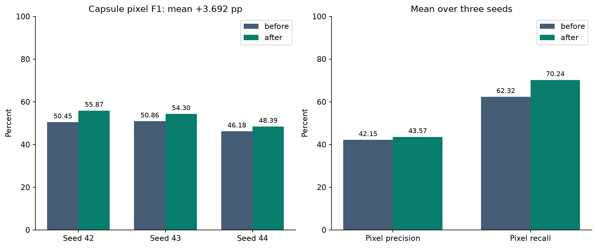

# 精度优化第二轮对比报告：FineGuard v1

日期：2026-10-26。基于 anomalib / PatchCore 的胶囊缺陷定位改进。

胶囊三个种子的平均像素 F1：**0.491633 → 0.528549，提升 3.692 个百分点**。

冻结配置：`r384-l2-t1.2`。本次完成 201 次测试图像评估，含跨种子重复图像。原有四项检测指标与召回率逐种子非退化验收：**通过**。

## 全部测试结果

| 种子 | 原像素 F1 | 新像素 F1 | 提升（百分点） | 像素精确率（前→后） | 像素召回率（前→后） |
|---|---:|---:|---:|---|---|
| 42 | 0.504471 | 0.558706 | +5.423 | 48.04% → 49.90% | 53.11% → 63.47% |
| 43 | 0.508643 | 0.543002 | +3.436 | 45.19% → 46.47% | 58.16% → 65.30% |
| 44 | 0.461785 | 0.483939 | +2.215 | 33.22% → 34.33% | 75.69% → 81.95% |

| 三种子均值 | 原始 | 优化后 |
|---|---:|---:|
| image_AUROC | 0.952020 | 0.952020 |
| image_F1Score | 0.958012 | 0.958012 |
| pixel_AUROC | 0.983365 | 0.983365 |
| pixel_F1Score | 0.491633 | 0.528549 |

图像 AUROC、图像 F1、像素 AUROC 逐种子完全一致。保留原评分和连续热力图，改进发生在最终二值缺陷掩码；不把这一结果描述为分类准确率提高。瓶子与电缆的部署模型本轮未改动，也不宣称获得新精度收益。

## 方法、筛选与复现口径

原分支采用 224×224 输入、ResNet18 layer2+layer3。辅助分支采用 384×384 输入、ResNet18 layer2，正常训练特征的 1% coreset。辅助异常图以双线性插值映射到原 224×224 坐标。仅在原模型判为异常的图像中补充高置信度像素，最终掩码为原掩码与补充掩码的并集。

补检阈值为各辅助模型原验证校准阈值的 1.2 倍。并集保留所有原阳性像素，所以召回率不会因删除旧区域而下降；F1 和精确率仍须实测，无法由并集结构保证。

候选仅在各自验证集比较。三个种子使用同一分支配置和阈值倍数，要求每个种子的验证 F1、精确率均不下降，F1 增益的按图片配对 bootstrap 95% 区间下限为正，平均 F1 至少增加 0.01，再按平均区间下限选择。参数与权重在测试前冻结。

两组高分辨率候选共六次训练完成；layer1+layer2 候选因 4 GB 笔记本训练开销过高，在测试前停止，保留部分日志。较早的 3%/5% 特征库和仅 layer2 单分支共九组验证结果，以及较早的掩码并集失败筛选，都保留在本地；单分支结果也纳入 JSON，避免只报告成功尝试。

冻结配置 SHA256：`c8467a7eb221eca01a81ccacb7d8c8a14a4eb6241c26742d4e7b7e3af18ea8c7`。首次测试发现 CPU/GPU 缩放造成微小像素 AUROC 差异。修复为上游数据模块的 CPU 缩放、设备侧归一化路径后，用相同权重和阈值重跑；后续中断修复的是审计脚本的设备迁移、掩码类型、参考标量所在设备及 NumPy 布尔序列化处理。没有根据测试指标重新调参。原始日志与实现变更哈希均保留。

## 不确定性与代价

本数据集已用于此前研究，各种子的图片有重叠。这是历史数据上的回归对比，不是独立外部数据上的一次性验证。以下区间仅作描述，未进行多候选比较校正：
- S42 像素 F1 增益区间：[2.469, 12.050] 个百分点。
- S43 像素 F1 增益区间：[1.548, 7.102] 个百分点。
- S44 像素 F1 增益区间：[0.966, 5.150] 个百分点。

| 种子 | 原预处理+推理中位耗时 ms | 新中位耗时 ms | 原/新增量张量峰值 MiB |
|---|---:|---:|---:|
| 42 | 10.615 | 26.353 | 8.31 / 23.84 |
| 43 | 10.705 | 26.060 | 8.31 / 23.84 |
| 44 | 10.796 | 26.323 | 8.31 / 23.84 |

计时使用同一原尺寸 GPU 输入、10 次预热和 40 次交替同步测量，包括 CPU 缩放/传输、模型及后处理，不含读图、绘图与启动。测量时两分支均常驻，因此增量张量峰值仅表示执行工作空间，不代表独立部署总显存；不能与之前只测模型前向的耗时混比。额外辅助模型会增加存储、加载与推理成本，不能声称速度或模型大小同步改善。

之前的推理会话复用仍可使用。旧无损组合包的 75.63% 缩减只针对旧九模型包，不能套用于新增辅助权重。

## 使用与复现

已完成 39 项自动化测试；真实预测成功生成图像，重复预测签名一致且命中模型缓存。GUI 报告页、三组模型选项及报告下载接口已核对。

图像检测 → 胶囊 → `PatchCore-R18-384 + FineGuard v1`。保留原基线作为默认；必须同时保留新模型目录中的 baseline.ckpt、auxiliary.ckpt 和 metrics.json。

实验目录：`course/outputs/fine-study-v3/`。训练用 `study_fine.py`，验证筛选用 `select_fine_guard.py`，冻结审计用 `audit_fine_guard.py`，注册用 `register_fine_guard.py`，本报告用 `report_fine_guard.py` 生成。既有冻结文件不得覆盖；新研究应使用新目录。辅助脚本和资源排除记录体现本次实验过程，未完成候选不能算作精度失败。

明细：`course/results/fine_metrics.json`；表格：`course/results/fine_metrics.csv`。
